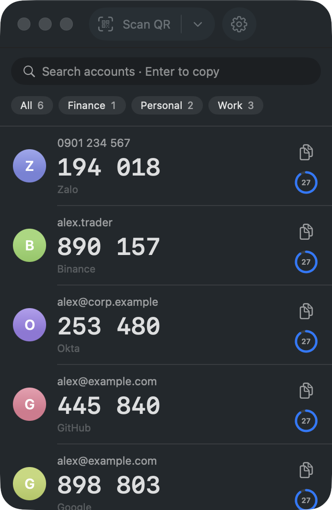
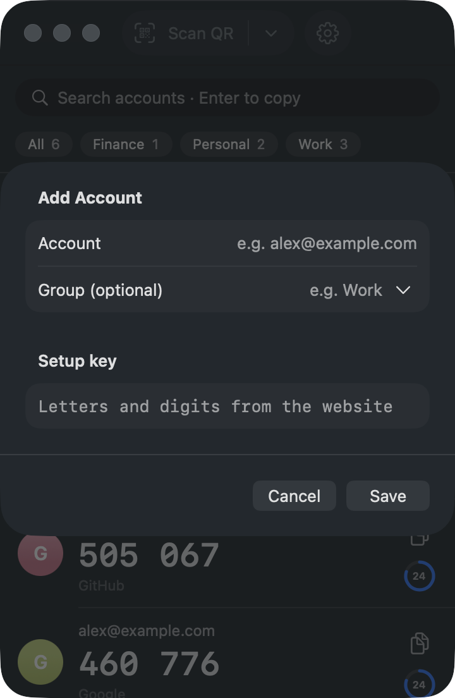

# 2FA Auth for macOS

**English** · [Tiếng Việt](README.vi.md)

A small Mac app for 2FA codes that scans QR codes from **anywhere on screen**: any Chrome profile, Safari, a chat
app, an image. Keys stay in your Keychain, offline.

<p>
  
  
</p>

## Install

1. Download **2FA-Auth-0.3.zip** from [Releases](https://github.com/thanhnhoncntt/2fa-auth-mac/releases/latest)
   (macOS 14+, Apple Silicon and Intel) and drag **2FA Auth.app** into **Applications**.
2. The app is not notarized, so the first launch is blocked: click **Done**, then
   **System Settings → Privacy & Security → Open Anyway**. Once only.
   Or: `xattr -dr com.apple.quarantine "/Applications/2FA Auth.app"`
3. On the first QR scan, allow **Screen Recording**.

## Use

- **⌥⇧A** shows or hides the window; **⌥⇧Q** scans a QR code (drag a box around it, `Esc` cancels).
- Click a row to copy its code, or type to search and press **Enter**. The clipboard is cleared after 30 seconds.
- **Profiles** (⚙ Settings → Profiles): separate account lists, like Chrome profiles. Switch with the menu at the
  top or ⌘1, ⌘2…; the menu only shows once you have a second profile.
- Right-click a row to edit or delete; right-click the menu bar icon for a quick menu.
- **Moving from another app?** ⚙ Settings → **Import from File…** reads exports of the Authenticator Chrome extension,
  Aegis, 2FAS, andOTP, Bitwarden, Ente Auth and otpauth:// lists. For Google Authenticator, scan its export QR codes.
- ⚙ Settings also has the password-protected backup of 2FA Auth itself (every profile or only some; restore picks
  which profiles come back and where, and never deletes anything), language, Touch ID lock and open at login.

## Build

```sh
swift test
./scripts/build-app.sh --install   # build and install to ~/Applications
./scripts/build-app.sh --release   # dist/2FA-Auth-<version>.zip for Releases
```

## License

[MIT](LICENSE)
