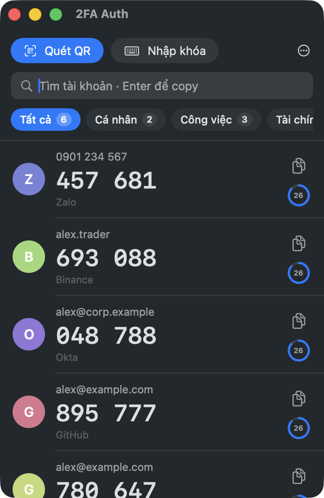
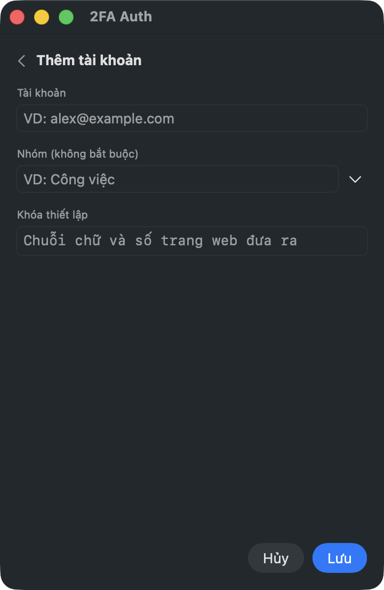

# 2FA Auth cho macOS

[English](README.md) · **Tiếng Việt**

App Mac nhỏ tạo mã 2FA, quét được mã QR ở **bất kỳ đâu trên màn hình**: mọi profile Chrome, Safari, app chat, ảnh.
Khóa nằm trong Keychain của máy, không lên mạng.

<p>
  
  
</p>

## Cài đặt

1. Tải **2FA-Auth-0.2.zip** ở [Releases](https://github.com/thanhnhoncntt/2fa-auth-mac/releases/latest)
   (macOS 14+, chip Apple và Intel), kéo **2FA Auth.app** vào **Applications**.
2. App chưa được Apple công chứng nên lần đầu bị chặn: bấm **Xong**, rồi
   **Cài đặt hệ thống → Quyền riêng tư & Bảo mật → Vẫn mở**. Chỉ một lần.
   Hoặc: `xattr -dr com.apple.quarantine "/Applications/2FA Auth.app"`
3. Lần đầu quét QR, cho phép **Ghi màn hình**.

## Dùng

- **⌥⇧A** hiện hoặc ẩn cửa sổ; **⌥⇧Q** quét mã QR (kéo khung quanh mã, `Esc` để huỷ).
- Bấm vào dòng để copy mã, hoặc gõ để tìm rồi **Enter**. Clipboard tự xoá sau 30 giây.
- Chuột phải vào dòng để sửa hoặc xoá; chuột phải vào icon trên thanh menu để mở menu nhanh.
- Menu **⋯**: sao lưu và khôi phục có mã hoá, ngôn ngữ (English / Tiếng Việt), khoá Touch ID, mở khi đăng nhập.

## Build

```sh
swift test
./scripts/build-app.sh --install   # build và cài vào ~/Applications
./scripts/build-app.sh --release   # dist/2FA-Auth-<phiên bản>.zip để đăng Releases
```

## Giấy phép

[MIT](LICENSE)
